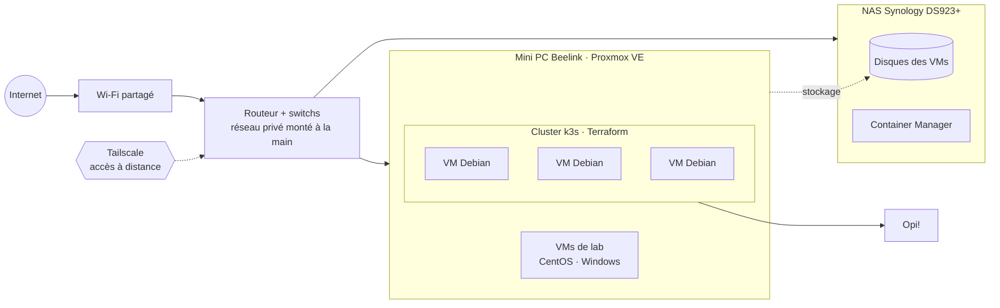

# Salut, moi c'est Alan 👋

**Ingénieur infrastructure / DevOps en construction**, étudiant en Master TRI (Télécom, Réseaux, Informatique) à l'Université Savoie Mont-Blanc, en alternance au Département de la Savoie.

J'aime l'informatique quand elle a une matérialité : des switches, des serveurs, des VMs, des conteneurs… et des réseaux qui tombent. Mon parcours n'a rien de linéaire (maintenance industrielle → réseaux → développement → systèmes → DevOps), et c'est justement ce qui me plaît : comprendre une infra de bout en bout, du câble jusqu'au déploiement.

J'apprends surtout en construisant : la plupart de ce qui est ci-dessous tourne (ou a tourné) sur mon homelab.

🌐 [alansalmon.fr](https://www.alansalmon.fr) · 💼 [LinkedIn](https://www.linkedin.com/in/alan-salmon-a09b50234) · ✉️ contact@alansalmon.fr

---

## 🔭 En ce moment

- ☸️ J'apprends **Kubernetes** sur un cluster k3s monté sur mon Proxmox, provisionné avec **Terraform**
- 🛰️ Je construis **Verkko**, un outil pour cartographier les réseaux privés de mon homelab
- 🇫🇮 J'apprends le **finnois** — *opettelen suomea !* — avec en tête un projet d'installation en Finlande après mon master

---

## 🧱 Projets

| Projet | En bref | Stack |
|---|---|---|
| 🛰️ **Verkko** | Outil web qui scanne mes réseaux privés et liste les appareils connectés : IP, état des VMs, du NAS, plage DHCP. Conçu en POO, documenté avec Sphinx. | Python · POO · Sphinx |
| 🇫🇮 **Opi!** | Plateforme d'apprentissage du finnois (verbes, phrases, vocabulaire), déployée comme une vraie appli en prod sur mon homelab. | Flask · Redis · Docker · k3s · Terraform |
| 🏠 **Homelab** | Mon terrain de jeu : virtualisation, conteneurs, réseau privé monté à la main, cluster Kubernetes. [Voir le schéma ↓](#-homelab) | Proxmox · Debian · Synology · Tailscale |
| 📦 **HomeStock** | Application mobile d'inventaire (iOS/Android) : produits et catégories en CRUD complet, persistance locale, filtrage par catégorie. Construite version après version pour apprendre React Native proprement. | React Native · Expo · TypeScript · SQLite |
| 🛒 **[ContApp](https://www.alansalmon.fr/projects/contapp.html)** | Projet DevOps de groupe (BUT R&T) : déploiement de bout en bout d'une appli e-commerce en microservices. | Python · Flask · NATS · Docker · Kubernetes · OpenStack |
| 🔇 **[Silence Remover](https://www.alansalmon.fr/projects/silence_remover.html)** | Traitement audio : détecte et supprime les silences d'un fichier, avec visualisation des échantillons. | Python · Matplotlib |

> Mes projets sont privés pour l'instant : je les construis avant tout pour apprendre. Je les présente plus en détail sur [mon site](https://www.alansalmon.fr), et je suis toujours partant pour en parler !

---

## 🏠 Homelab

Quelques choix et contraintes :
- **Pas d'accès à la box** (Wi-Fi partagé en appartement) → j'ai monté mon propre réseau privé derrière, et j'y accède à distance via **Tailscale**
- **Disques des VMs sur le NAS** → le mini PC reste léger, le stockage est centralisé
- **Terraform** pour créer les VMs du cluster plutôt que de les cliquer à la main

---

## 🛠️ Stack

**Infra & systèmes**

**Conteneurs & IaC**

**Réseaux & monitoring**

**Dev & données**

---

🏒 Hors écran : fan des Brûleurs de Loups et des Oulun Kärpät.
